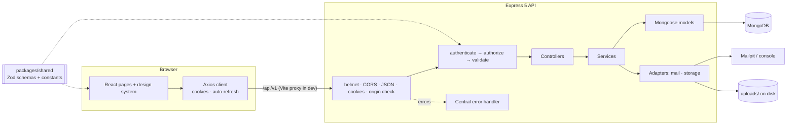
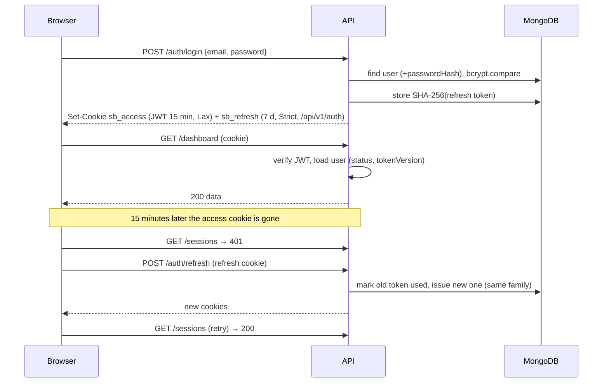

# Architecture

SkillBridge is an npm-workspaces monorepo with three packages: a React single-page app (`apps/client`), an Express REST API (`apps/server`) and a shared package (`packages/shared`) holding constants and Zod validation schemas that both sides import. MongoDB stores all data. This document reflects the approved Stage 3 proposal and what was actually built in Sprint 1.

## Frontend

| Concern          | How it is done                                                                                                                                                  | Files                                                                   |
| ---------------- | --------------------------------------------------------------------------------------------------------------------------------------------------------------- | ----------------------------------------------------------------------- |
| Routing          | React Router 8 data router; route groups: public, guest-only, signed-in, admin                                                                                  | `src/routes/routes.jsx`, `src/routes/guards.jsx`                        |
| Layouts          | `PublicLayout` (landing), `AuthLayout` (split screen), `AppLayout` (sidebar, top bar, drawer on phones)                                                         | `src/layouts/*`                                                         |
| Who is logged in | `AuthContext` calls `GET /auth/me` on start; `status` = loading / authenticated / guest                                                                         | `src/context/AuthContext.jsx`                                           |
| API access       | One Axios instance with `withCredentials`; 401 → single shared `POST /auth/refresh` → retry; every failure becomes `ApiError { status, code, message, fields }` | `src/services/apiClient.js`, `src/features/api.js`                      |
| Data loading     | `useApi(fetcher, deps)` returns `{ data, meta, loading, error, reload, setData }` and ignores stale responses                                                   | `src/hooks/useApi.js`                                                   |
| Forms            | `useForm` validates with the shared Zod schema on blur/submit, shows server field errors, focuses an error summary                                              | `src/hooks/useForm.js`, `components/ui/Form.jsx`                        |
| Design system    | CSS variables in `tokens.css`; CSS Modules per component; teach = teal, learn = amber                                                                           | `src/styles/*`, `src/components/ui/*`                                   |
| Feedback         | Toasts (`aria-live`), skeletons, empty and error states (`AsyncView`), confirm dialogs, focus-trapped modals                                                    | `context/ToastContext.jsx`, `components/ui/Feedback.jsx`, `Overlay.jsx` |

Feature code lives in `src/features/<feature>/` (components specific to profile, skills, availability, sessions, search). Pages in `src/pages/` compose features and the UI kit.

## Backend

Request flow: **route → guards → validate → controller → service → model**.

| Layer             | Responsibility                                                                                                                            | Never does         |
| ----------------- | ----------------------------------------------------------------------------------------------------------------------------------------- | ------------------ |
| `routes/index.js` | URL + method → guards, validator, controller. `authenticate` is applied once to the whole signed-in router, so no endpoint can forget it. | Business logic     |
| `middleware/`     | `authenticate`, `authorize(role)`, `validate({ body, query, params })`, `avatarUpload`, `originCheck`, `errorHandler`                     | Database writes    |
| `controllers/`    | Read `req.validated`, call one service, send the envelope                                                                                 | Query MongoDB      |
| `services/`       | All rules: ownership, password rules, token rotation, search building                                                                     | Touch `req`/`res`  |
| `models/`         | Schemas, field validation, indexes                                                                                                        | Business decisions |
| `integrations/`   | Mail (Mailpit/console/memory) and file storage (local disk) behind small interfaces                                                       | —                  |

Errors: services throw `AppError(status, code, message, { fields, details })`. Express 5 forwards async errors to `errorHandler`, which also translates Mongoose duplicate-key (409), cast (400) and validation (422) errors and hides anything unexpected behind a generic 500.

## Database

Six collections in Sprint 1: `users` (with embedded teach/learn skills and availability), `categories`, `skills`, `refreshtokens`, `passwordresets`, `sessions`. Full field list, rules and indexes: [database/README.md](../database/README.md).

## Authentication flow

- **Logout** revokes the refresh token and clears both cookies.
- **Reuse detection:** presenting an already-used refresh token revokes every token in that login family.
- **Password change/reset** increments `tokenVersion` (old access tokens stop working) and revokes all refresh tokens.
- **Why cookies, not localStorage:** HTTP-only cookies cannot be read by injected scripts (XSS). CSRF is handled by SameSite cookies, JSON-only write endpoints and the `originCheck` middleware.

## Authorization

| Rule               | Enforcement                                                                                          |
| ------------------ | ---------------------------------------------------------------------------------------------------- |
| Signed-in only     | `authenticate` on the whole secured router (tested against every route)                              |
| Admin-only         | `authorize('admin')` on `/admin/*`                                                                   |
| Own data only      | Profile, skill and availability routes exist only under `/users/me`                                  |
| Public fields only | Other users are always serialised with `toPublicProfile()` (`utils/serializers.js`)                  |
| Deactivated users  | Blocked in `authenticate`; excluded from search; public profile returns 404                          |
| Safety rails       | Admins cannot deactivate themselves; the last active admin cannot delete or deactivate their account |

The client guards (`ProtectedRoute`, `GuestRoute`, `AdminRoute`) only improve the experience; the server decides everything on its own.

## Security summary

Helmet headers with a strict Content-Security-Policy, HSTS in HTTPS mode, CORS limited to `CLIENT_ORIGIN`, 100 kB JSON body limit, bcrypt cost 12, opaque hashed refresh and reset tokens, same message for unknown email and wrong password (plus dummy hash for equal timing), file uploads checked by size, MIME type **and** file signature, regex-escaped search input, a configuration check that refuses weak JWT secrets.

## Future cloud integration

Each local piece sits behind an interface so next semester can swap it without touching services:

| Local now                                               | Next semester                                                | Change                                        |
| ------------------------------------------------------- | ------------------------------------------------------------ | --------------------------------------------- |
| `integrations/storage/localDiskStorage.js` + `/uploads` | Amazon S3 + CloudFront, pre-signed URLs                      | New adapter with the same `save` / `remove`   |
| `integrations/mail` (Mailpit)                           | Amazon SES                                                   | New transport                                 |
| Seeded demo sessions                                    | Sessions created on match acceptance (SB2) and booking (SB3) | New services; `sessions` collection unchanged |
| — (Sprint 2)                                            | SQS + Lambda matchmaking, Redis, WebSockets, WebRTC          | Planned in Stage 3, not implemented now       |
| Local HTTPS via mkcert                                  | Managed TLS at deployment                                    | Infrastructure only                           |
