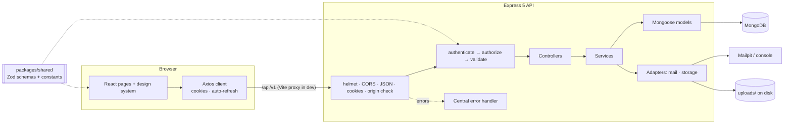
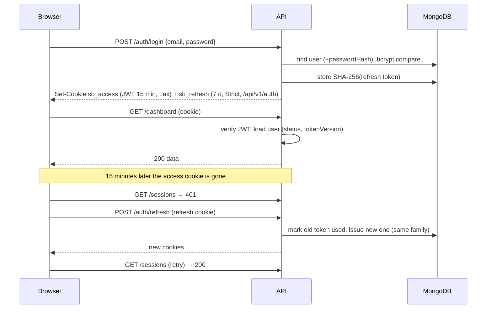
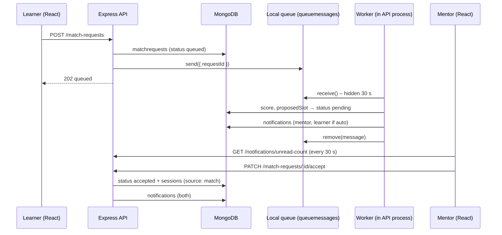

# Architecture

SkillBridge is an npm-workspaces monorepo with three packages: a React single-page app (`apps/client`), an Express REST API (`apps/server`) and a shared package (`packages/shared`) holding constants and Zod validation schemas that both sides import. MongoDB stores all data. This document reflects the approved Stage 3 proposal and what was actually built in Sprints 1 and 2. Sprint 2 sections are near the end.



## Frontend

| Concern          | How it is done                                                                                                                                                  | Files                                                                   |
| ---------------- | --------------------------------------------------------------------------------------------------------------------------------------------------------------- | ----------------------------------------------------------------------- |
| Routing          | React Router 8 data router; route groups: public, guest-only, signed-in, admin                                                                                  | `src/routes/routes.jsx`, `src/routes/guards.jsx`                        |
| Layouts          | `PublicLayout` (landing), `AuthLayout` (split screen), `AppLayout` (sidebar, top bar, drawer on phones)                                                         | `src/layouts/*`                                                         |
| Who is logged in | `AuthContext` calls `GET /auth/me` on start; `status` = loading / authenticated / guest                                                                         | `src/context/AuthContext.jsx`                                           |
| API access       | One Axios instance with `withCredentials`; 401 → single shared `POST /auth/refresh` → retry; every failure becomes `ApiError { status, code, message, fields }` | `src/services/apiClient.js`, `src/features/api.js`                      |
| Data loading     | `useApi(fetcher, deps)` returns `{ data, meta, loading, error, reload, setData }` and ignores stale responses                                                   | `src/hooks/useApi.js`                                                   |
| Forms            | `useForm` validates with the shared Zod schema on blur/submit, shows server field errors, focuses an error summary                                              | `src/hooks/useForm.js`, `components/ui/Form.jsx`                        |
| Design system    | CSS variables in `tokens.css`; CSS Modules per component; teach = teal, learn = amber                                                                           | `src/styles/*`, `src/components/ui/*`                                   |
| Feedback         | Toasts (`aria-live`), skeletons, empty and error states (`AsyncView`), confirm dialogs, focus-trapped modals                                                    | `context/ToastContext.jsx`, `components/ui/Feedback.jsx`, `Overlay.jsx` |

Feature code lives in `src/features/<feature>/` (components specific to profile, skills, availability, sessions, search). Pages in `src/pages/` compose features and the UI kit.

## Backend

Request flow: **route → guards → validate → controller → service → model**.

| Layer             | Responsibility                                                                                                                            | Never does         |
| ----------------- | ----------------------------------------------------------------------------------------------------------------------------------------- | ------------------ |
| `routes/index.js` | URL + method → guards, validator, controller. `authenticate` is applied once to the whole signed-in router, so no endpoint can forget it. | Business logic     |
| `middleware/`     | `authenticate`, `authorize(role)`, `validate({ body, query, params })`, `avatarUpload`, `originCheck`, `errorHandler`                     | Database writes    |
| `controllers/`    | Read `req.validated`, call one service, send the envelope                                                                                 | Query MongoDB      |
| `services/`       | All rules: ownership, password rules, token rotation, search building                                                                     | Touch `req`/`res`  |
| `models/`         | Schemas, field validation, indexes                                                                                                        | Business decisions |
| `integrations/`   | Mail (Mailpit/console/memory) and file storage (local disk) behind small interfaces                                                       | —                  |

Errors: services throw `AppError(status, code, message, { fields, details })`. Express 5 forwards async errors to `errorHandler`, which also translates Mongoose duplicate-key (409), cast (400) and validation (422) errors and hides anything unexpected behind a generic 500.

## Database

Six collections in Sprint 1: `users` (with embedded teach/learn skills and availability), `categories`, `skills`, `refreshtokens`, `passwordresets`, `sessions`. Sprint 2 adds `matchrequests`, `notifications` and `queuemessages`, a skill text index and `users.acceptingRequests`. Full field list, rules and indexes: [database/README.md](../database/README.md).

## Authentication flow



- **Logout** revokes the refresh token and clears both cookies.
- **Reuse detection:** presenting an already-used refresh token revokes every token in that login family.
- **Password change/reset** increments `tokenVersion` (old access tokens stop working) and revokes all refresh tokens.
- **Why cookies, not localStorage:** HTTP-only cookies cannot be read by injected scripts (XSS). CSRF is handled by SameSite cookies, JSON-only write endpoints and the `originCheck` middleware.

## Authorization

| Rule               | Enforcement                                                                                          |
| ------------------ | ---------------------------------------------------------------------------------------------------- |
| Signed-in only     | `authenticate` on the whole secured router (tested against every route)                              |
| Admin-only         | `authorize('admin')` on `/admin/*`                                                                   |
| Own data only      | Profile, skill and availability routes exist only under `/users/me`                                  |
| Public fields only | Other users are always serialised with `toPublicProfile()` (`utils/serializers.js`)                  |
| Deactivated users  | Blocked in `authenticate`; excluded from search; public profile returns 404                          |
| Safety rails       | Admins cannot deactivate themselves; the last active admin cannot delete or deactivate their account |

The client guards (`ProtectedRoute`, `GuestRoute`, `AdminRoute`) only improve the experience; the server decides everything on its own.

## Security summary

Helmet headers with a strict Content-Security-Policy, HSTS in HTTPS mode, CORS limited to `CLIENT_ORIGIN`, 100 kB JSON body limit, bcrypt cost 12, opaque hashed refresh and reset tokens, same message for unknown email and wrong password (plus dummy hash for equal timing), file uploads checked by size, MIME type **and** file signature, regex-escaped search input, a configuration check that refuses weak JWT secrets.

## Sprint 2: skill and mentor discovery (SB2/US1–7, 32–42)

```mermaid
flowchart LR
  Q[q = "react, vue"] --> SAN[sanitizeSearchText + splitSearchTerms<br/>packages/shared/src/search.js]
  SAN --> P[Partial match<br/>regex on normalizedName / aliases]
  SAN --> TX[MongoDB $text<br/>skill_text index]
  P --> SK[Matching skills + match score]
  TX --> SK
  SK --> U[Active users teaching them<br/>≠ searcher, ≤ 500 candidates]
  U --> FL[Filters: category · min level ·<br/>availability window · ±3 h zone]
  FL --> RK[Relevance / name / newest / shared time]
  RK --> PG[Page ≤ 50 + total + applied filters]
```

`searchService.searchMentors` runs the pipeline; filters that need time-zone maths run in Node on at most 500 candidates, which is fast enough for a demo-sized community and keeps the queries simple. An empty result returns `relatedSkills` so the page can offer alternatives. The Discover page keeps every setting in the URL.

## Sprint 2: learning requests, local queue and matching (SB2/US12–31, 43–50)



- **State machine** (`packages/shared/src/requests.js`): every change names who may make it; the API rejects anything else with 409. The UI shows only the buttons `request.actions` allows, but the server re-checks.
- **Duplicates** are blocked twice: a service check (409 with the existing id) and the partial unique index on `matchrequests`.
- **Matching** (`services/matching/scoring.js`, pure functions): skill 35 + level 20 + shared time 25 + time-zone 10 + skill swap 10 = 100. Ties: more shared time, then name. Candidates must be active, accepting requests, have availability and teach the skill at or above the wanted level (direct requests skip the level rule because the learner chose the mentor). "Find me a mentor" also needs shared time. When nobody fits, `explainNoMatch` returns one of six reason codes with a next step.
- **Time zones** (`packages/shared/src/time.js`): weekly slots → "week minutes" in UTC with the built-in `Intl` API; overlaps, the gap between zones (round the clock), and the earliest shared 30-minute slot ≥ 24 h ahead.
- **Queue and worker** (`integrations/queue/localQueue.js`, `workers/matchWorker.js`): MongoDB-backed, same contract as the planned SQS adapter (`send`, `receive` with visibility timeout, `remove`, `release`, dead letter after 3 receives). The worker drains every second and right after each new request; an expiry job runs every 60 s. Tests call `worker.drain()` directly so nothing depends on timers.
- **Notifications** are documents written by the services on every event; the client polls the unread count every 30 s while the tab is visible and on every route change. This is a simplified stand-in for push.

## Sprint 2: light and dark theme (additional requirement)

| Piece          | What it does                                                                                                                                                                                                                                                       | File                                  |
| -------------- | ------------------------------------------------------------------------------------------------------------------------------------------------------------------------------------------------------------------------------------------------------------------ | ------------------------------------- |
| Design tokens  | Light values on `:root`; `:root[data-theme='dark']` redefines only colour and shadow tokens (≈ 60 variables). Every component uses tokens, so it supports both themes automatically.                                                                               | `src/styles/tokens.css`               |
| No-flash start | A tiny classic script in `<head>` reads `localStorage['sb-theme']` (`system`/`light`/`dark`), resolves `system` with `prefers-color-scheme`, and sets `<html data-theme>` before the first paint. It is a file, not inline, because the CSP blocks inline scripts. | `public/theme-init.js`, `index.html`  |
| State          | `ThemeProvider` (React context) holds `preference` and the resolved `theme`, follows OS changes while on `system`, writes `localStorage` (wrapped in try/catch), and adds a 250 ms `theme-transition` class only while switching.                                  | `src/context/ThemeContext.jsx`        |
| Controls       | Sun/moon `ThemeToggle` in the app top bar, public header and auth screens (announces "Dark theme on"); Settings → Appearance offers System / Light / Dark.                                                                                                         | `src/features/theme/*`                |
| Brand panel    | The auth-screen brand gradient and its chips use `--brand-*` tokens that stay the same in both themes.                                                                                                                                                             | `tokens.css`, `AuthLayout.module.css` |

**Adding a component later:** use only `var(--color-…)`, `var(--shadow-…)` and `var(--brand-…)` tokens — never hex or rgb values. If a new colour is needed, add it to both the `:root` block and the dark block. The theme tests fail if a light colour token has no dark value, and they check WCAG AA contrast for the main text/background pairs.

## Future cloud integration

Each local piece sits behind an interface so next semester can swap it without touching services:

| Local now                                               | Next semester                                       | Change                                                              |
| ------------------------------------------------------- | --------------------------------------------------- | ------------------------------------------------------------------- |
| `integrations/storage/localDiskStorage.js` + `/uploads` | Amazon S3 + CloudFront, pre-signed URLs             | New adapter with the same `save` / `remove`                         |
| `integrations/mail` (Mailpit)                           | Amazon SES                                          | New transport                                                       |
| `integrations/queue/localQueue.js` (MongoDB)            | Amazon SQS (+ dead-letter queue)                    | New adapter with the same `send` / `receive` / `remove` / `release` |
| `workers/matchWorker.js` calling `processRequest()`     | AWS Lambda triggered by SQS                         | Wrap `processRequest(requestId)` in a handler                       |
| Notification polling every 30 s                         | Push (WebSockets / SNS)                             | Same `notifications` collection; new delivery                       |
| —                                                       | Redis caching, WebRTC sessions, booking (Sprint 3+) | Not started                                                         |
| Local HTTPS via mkcert                                  | Managed TLS at deployment                           | Infrastructure only                                                 |
