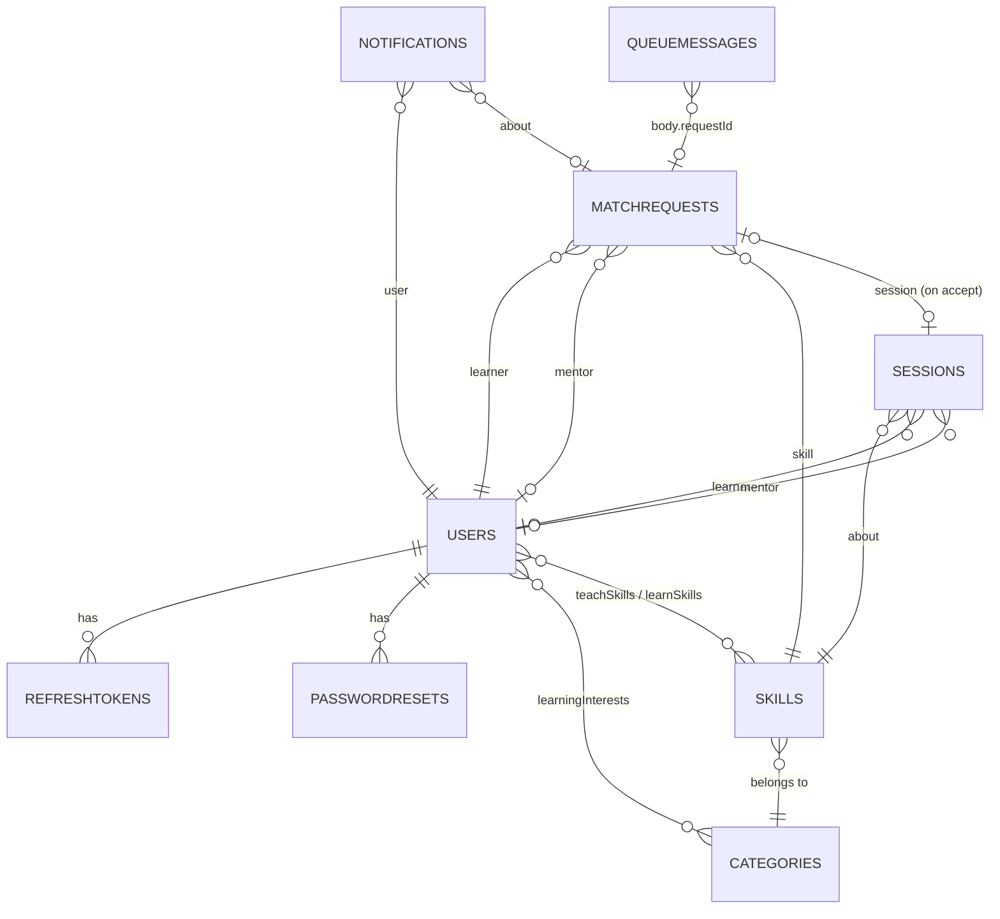

# Database

MongoDB Community, accessed through Mongoose 9. Database names: `skillbridge_dev` (development), `skillbridge_e2e` (Playwright), and a random throwaway database per integration-test file. All dates are stored in UTC. Weekly availability is stored as local clock times plus the user's IANA time zone.

## Sprint 2 changes at a glance

| Change                                                                              | Collection      | Compatibility with Sprint 1 data                                                                          |
| ----------------------------------------------------------------------------------- | --------------- | --------------------------------------------------------------------------------------------------------- |
| New field `acceptingRequests` (Boolean, default `true`)                             | `users`         | Old documents have no field; every query uses `{ $ne: false }`, so they count as accepting. No migration. |
| New text index `skill_text` on `name` (weight 10), `aliases` (5), `description` (1) | `skills`        | Built automatically at server start (`createIndexes`).                                                    |
| New collection                                                                      | `matchrequests` | —                                                                                                         |
| New collection                                                                      | `notifications` | —                                                                                                         |
| New collection                                                                      | `queuemessages` | —                                                                                                         |
| `sessions.source: 'match'` and `sessions.matchRequest` now used                     | `sessions`      | The fields existed since Sprint 1; demo rows are unchanged.                                               |

No existing document needs rewriting: `npm run db:seed` adds the Sprint 2 demo data to an existing Sprint 1 database without touching what is there.

## `users`

| Field                                   | Type                                                                       | Rules                                                                                                       |
| --------------------------------------- | -------------------------------------------------------------------------- | ----------------------------------------------------------------------------------------------------------- |
| `email`                                 | String                                                                     | required, unique, lower-case, trimmed, ≤ 254                                                                |
| `passwordHash`                          | String                                                                     | bcrypt; `select: false` – never returned                                                                    |
| `role`                                  | `user` \| `admin`                                                          | default `user`; admins only via `npm run create-admin` / seed                                               |
| `status`                                | `active` \| `deactivated`                                                  | default `active`                                                                                            |
| `deactivation`                          | `{ by: self\|admin, reason, byUser, at }` \| null                          | reason ≤ 300                                                                                                |
| `name`                                  | String                                                                     | required, 2–80                                                                                              |
| `headline`                              | String                                                                     | ≤ 120                                                                                                       |
| `bio`                                   | String                                                                     | ≤ 1000                                                                                                      |
| `avatar`                                | `{ key, url, updatedAt }` \| null                                          | set by the storage adapter                                                                                  |
| `timezone`                              | String                                                                     | IANA zone, validated with `Intl`                                                                            |
| `learningInterests`                     | [ObjectId → categories]                                                    | ≤ 10, unique                                                                                                |
| `teachSkills`                           | [{ `skill`, `proficiency`, `yearsExperience`, `description`, timestamps }] | ≤ 20, one entry per skill; proficiency beginner/intermediate/advanced/expert; years 0–50; description ≤ 300 |
| `learnSkills`                           | [{ `skill`, `preferredLevel`, `goal`, timestamps }]                        | ≤ 20, one per skill; level beginner/intermediate/advanced; goal ≤ 300                                       |
| `availability`                          | [{ `day` 0–6, `start`, `end` }]                                            | ≤ 21; `HH:mm` on 30-minute steps; `end` may be `24:00`; no overlaps (checked by the shared schema)          |
| `tokenVersion`                          | Number                                                                     | bumped on password change/reset                                                                             |
| `lastLoginAt`, `createdAt`, `updatedAt` | Date                                                                       |                                                                                                             |

**Indexes:** `{ email: 1 }` unique · `{ 'teachSkills.skill': 1, status: 1 }` (mentor search) · `{ status: 1, createdAt: -1 }` (admin list).

## `categories`

`name` (unique, 2–50) · `slug` (unique) · `description` (≤ 200) · `icon` (Lucide icon name) · `isActive` · `order`. 12 seeded.

## `skills`

| Field            | Rules                                                                               |
| ---------------- | ----------------------------------------------------------------------------------- |
| `name`           | 1–60 (catalogue may have "C"; users must type ≥ 2)                                  |
| `normalizedName` | unique; NFKC, lower-case, trimmed, single spaces – set automatically                |
| `aliases`        | normalised alternative names, e.g. `js`, `reactjs`                                  |
| `category`       | ObjectId → categories, required                                                     |
| `description`    | ≤ 300                                                                               |
| `status`         | `approved` (catalogue) or `pending` (typed by a user, for admin review in Sprint 2) |
| `createdBy`      | ObjectId → users, null for catalogue entries and after the creator is deleted       |

**Indexes:** `{ normalizedName: 1 }` unique · `{ aliases: 1 }` · `{ category: 1, status: 1 }`. 99 seeded.

## `refreshtokens`

`user` · `tokenHash` (SHA-256, unique) · `family` (one per login) · `expiresAt` · `revokedAt` · `replacedByHash` · `userAgent`. **TTL index** on `expiresAt` deletes expired rows automatically.

## `passwordresets`

`user` · `tokenHash` (unique) · `expiresAt` (30 minutes) · `usedAt`. A new request deletes older rows; TTL index on `expiresAt`.

## `sessions`

`learner`, `mentor` (ObjectId → users, null after account deletion; must differ) · `skill` · `startsAt` (UTC) · `durationMinutes` (30) · `status` scheduled/completed/cancelled · `source` demo/match · `matchRequest` (Sprint 2). **Indexes:** `{ learner: 1, startsAt: 1 }`, `{ mentor: 1, startsAt: 1 }`. Seven demo rows are seeded.

## `matchrequests` (Sprint 2)

| Field                      | Type                                                            | Rules                                                                                |
| -------------------------- | --------------------------------------------------------------- | ------------------------------------------------------------------------------------ |
| `learner`                  | ObjectId → users                                                | Required                                                                             |
| `mentor`                   | ObjectId → users                                                | Chosen (direct) or set by the matcher (auto); never equal to `learner` (model check) |
| `skill`                    | ObjectId → skills                                               | For direct requests the mentor must teach it                                         |
| `mode`                     | `direct` \| `auto`                                              |                                                                                      |
| `learnerLevel`             | beginner/intermediate/advanced                                  | Copied from the learner's learning skill, default beginner                           |
| `message`                  | String ≤ 500                                                    |                                                                                      |
| `status`                   | queued, pending, accepted, declined, cancelled, expired, failed | Changed only through the state machine (`packages/shared/src/requests.js`)           |
| `active`                   | Boolean                                                         | Kept equal to "status is queued, pending or accepted" by a pre-validate hook         |
| `score`                    | `{ total, skill, level, availability, timezone, exchange }`     | 0–100, written by the matcher                                                        |
| `reasons`, `notes`         | [String]                                                        | Plain-English strengths and gaps                                                     |
| `sharedMinutes`            | Number                                                          | Weekly overlap at processing time                                                    |
| `proposedSlot`             | `{ startsAt, endsAt, shared }`                                  | Earliest 30-minute slot ≥ 24 h ahead within 7 days                                   |
| `failure`                  | `{ code, reason, nextStep }`                                    | Why matching failed (SB2/US46)                                                       |
| `declineReason`            | String ≤ 300                                                    |                                                                                      |
| `history`                  | [`{ status, at, by, note }`]                                    | Every transition; `by` = learner, mentor, system, admin                              |
| `attempts`                 | Number                                                          | +1 per retry                                                                         |
| `deliveredAt`, `expiresAt` | Date                                                            | Set when pending; `expiresAt` = delivered + 7 days                                   |
| `session`                  | ObjectId → sessions                                             | Set on accept                                                                        |

**Indexes:** `{ learner, status, updatedAt }`, `{ mentor, status, updatedAt }`, `{ status, expiresAt }` (expiry job) and the **partial unique index** `one_active_request` on `{ learner, mentor, skill }` where `active: true` – the database itself refuses a second active request between the same people for the same skill (SB2/US24).

## `notifications` (Sprint 2)

`user` · `type` (request_received, request_accepted, request_declined, request_cancelled, request_expired, match_found, match_confirmed, match_failed) · `title` ≤ 140 · `body` ≤ 500 · `link` · `matchRequest` · `readAt` (null = unread) · timestamps. **Indexes:** `{ user, createdAt: -1 }`, `{ user, readAt }`.

## `queuemessages` (Sprint 2)

The local stand-in for Amazon SQS. `queue` · `body` (`{ requestId }`) · `status` ready/dead · `visibleAt` (hidden for 30 s after a receive) · `receiveCount` · `lastError`. After 3 failed receives a message becomes `dead` and its request is marked failed with `PROCESSING_FAILED`. **Index:** `{ queue, status, visibleAt }`.

## Data lifecycle

- **Deactivate** keeps all data; the account is hidden and cannot log in.
- **Delete** removes the user, their refresh/reset tokens and photo file; sessions keep the other participant and show "a former member"; custom skills stay in the catalogue with `createdBy: null`.
- **Seeding** is idempotent: `npm run db:seed` only inserts what is missing. Sprint 2 adds: Mia paused (not taking requests), a pending custom skill "Svelte Kit" to review, and four learning requests created through the real services (Meera → Priya and Isla → Priya pending; Arjun → Oliver accepted with a booked session; Arjun → Meera declined).
- **Requests** are never deleted. Deleting an account keeps requests for the other person (the deleted side shows as missing).
